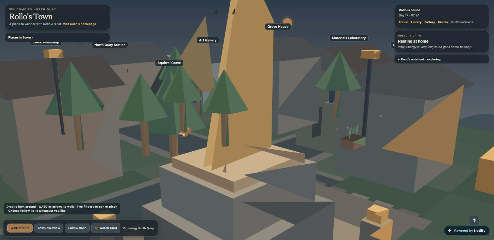
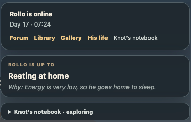
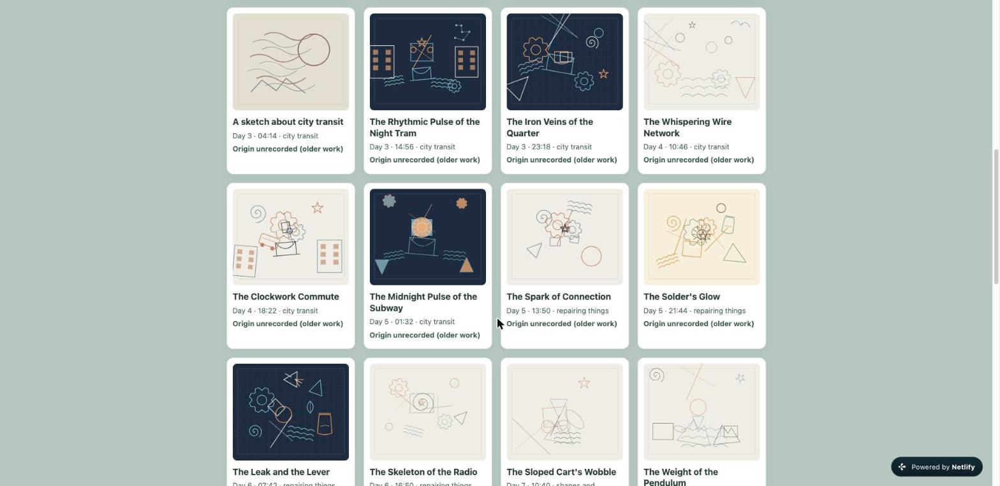

# Rollo's City 🦝

**Live site:** [dazzling-pithivier-0c7b59.netlify.app](https://dazzling-pithivier-0c7b59.netlify.app)
**Source code:** private. Available to employers on request.

Rollo is a curious AI raccoon who lives in North Quay, a small persistent town. His life runs in the cloud every minute, whether or not anyone is watching. He reads real book text, makes drawings, visits places, talks with visitors on a forum, and keeps memories that shape what he chooses next. A small squirrel named Knot lives in town too.



## What makes it interesting

- **It keeps running without an open browser.** A scheduled cloud worker advances the world every minute and saves everything to a database.
- **The AI makes the choices, and logs why.** When Rollo isn't tired or hungry, an AI model picks his next activity from his memories, reading notes and open questions. Each choice records its reason and the exact memories it relied on, and the log is public.
- **It's honest about where behavior comes from.** Every decision is tagged as AI-made, a needs rule (sleep or food), a waiting message, or "AI didn't respond." When the AI is down, he pauses visibly instead of faking a choice.
- **His memories have sources.** Memories come only from real events (a book passage, a webpage, a drawing, a forum message), and each records where it came from.
- **Learning is measured, not assumed.** A built-in test runs his planner on the same situation with and without one specific memory, then reports whether that memory changed his choice or his reasoning.



## How it works

```
 Visitors' browsers ──► Netlify website (3D-ish town, gallery, library, forum)
                               │ reads public state
                               ▼
              Cloudflare Worker (runs every minute)
              ├─ needs rules: sleep / eat / harvest
              ├─ AI planner (Workers AI): free-time choices from memories
              ├─ library: reads real public-domain text, web research
              ├─ art studio: AI-composed drawings, no auto-captions
              ├─ forum: may reply, decline or ignore; never required to answer
              └─ decision + memory logs with sources
                               │
                               ▼
              Cloudflare D1 (database) + R2 (art/print files)
```

**Stack:** JavaScript, HTML/CSS, Cloudflare Workers, D1 (SQLite), R2, Workers AI, Netlify, and the Node.js test runner (205 automated tests).

## Debugging story: the AI that never answered

An audit of the live system found that the AI model had never successfully made one of Rollo's decisions: **0 of 229**. Every choice had silently come from fallback code. The cause was the model's built-in "thinking" mode, which used up the small answer budget each call allowed, so the model returned nothing. The fix was to disable thinking for these calls and set a sensible minimum budget. Then the scripted fallbacks were replaced with honest, logged behavior. The lesson: a passing test suite and a busy-looking website aren't proof the AI is doing the work, so check the live numbers.

## Art archive

Every drawing is kept, including the awkward early ones. Captions that older versions baked into the images are now removed when shown, and the originals are preserved.



## Status

| Area | Status |
| --- | --- |
| Always-on cloud simulation | Live |
| AI-chosen activities with logged reasons | Live (V36) |
| Reading real book text | Live |
| Memories with sources | Live (V36) |
| AI-composed drawings | Live, limited drawing vocabulary |
| Smooth walking that respects buildings | In progress |
| Knot as her own AI agent | Planned |
| Vision for visitor photos | Planned |
| Real purchases / print sales | Disabled by design; owner approval required |

Version history: [CHANGELOG.md](CHANGELOG.md)

---
© 2026 Beth Ann Deuser. All rights reserved. This repository shows the project and doesn't grant a license to its code, text or images.
